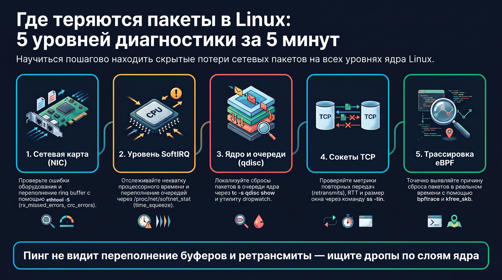

# linux-packet-drop-xray

> **Zero-dependency утилита 5-уровневой диагностики потерь пакетов в Linux (`ethtool -S`, `/proc/net/softnet_stat`, `tc -s qdisc`, `ss -tin`/`nstat` и eBPF `kfree_skb`) за 5 минут.**



## 5 уровней рентгена
1. **L1 — NIC и кольцевые буферы (`ethtool -S`):** `rx_missed_errors`, `rx_no_buffer_count`, `rx_crc_errors`, `rx_dropped`.
2. **L2 — Очереди SoftIRQ (`/proc/net/softnet_stat`):** декодирование hex-счётчиков `dropped` и `time_squeeze` по каждому ядру CPU.
3. **L3 — Очереди `qdisc` (`tc -s qdisc`):** сбросы `pfifo_fast`, буферблоат и `overlimits`.
4. **L4 — TCP-стек и сокеты (`ss -tin` + `nstat -az`):** `TcpExtListenOverflows`, `TcpExtTCPRcvQDrop`, `retrans` и `lost`.
5. **L5 — eBPF-рентген ядра (`ebpf/kfree_skb_reasons.bt`):** точная причина дропа (`skb_drop_reason`) и функция ядра (`SOCKET_RCVBUFF`, `NETFILTER_DROP` и др.).

## Быстрый старт (Python 3.11+, 0 зависимостей)

```bash
git clone https://github.com/cyberdub-ai/linux-packet-drop-xray.git
cd linux-packet-drop-xray

python -m packet_drop_xray analyze examples/incident_snapshot
python -m unittest discover -s tests -v
```

English documentation: [README.md](README.md) · Автор: Алексей Жуйков ([cyberdub.su](https://cyberdub.su))
